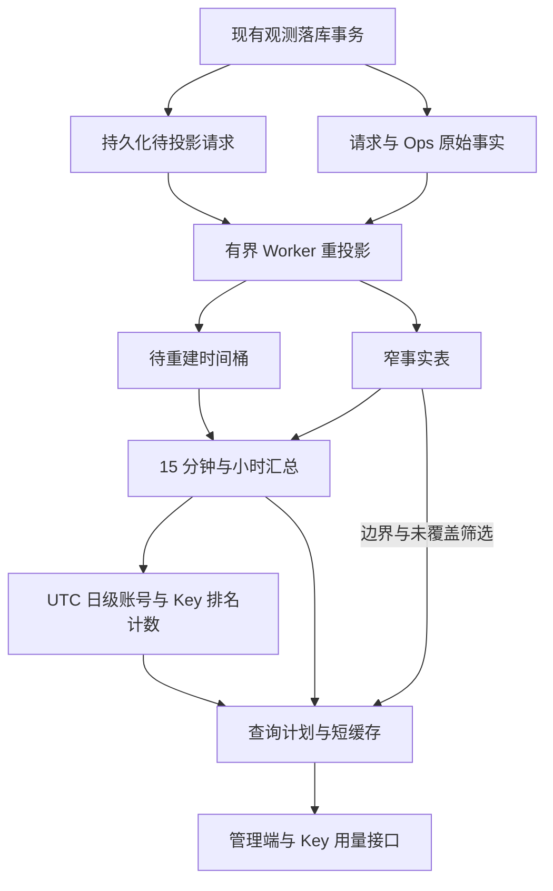

# 请求观测存储与大数据量统计设计

本文描述 [#382](https://github.com/zyycn/codex-proxy-rs/issues/382) 对应的当前工作区实现、运行边界与验收要求。接口合同见 [API 参考](../api.md#统计新鲜度与覆盖)，模块职责见 [系统架构](../architecture.md#统计投影与查询)，已取得的验证结果与未完成项见 [验收报告](382-scalability-validation.md)

## 范围与边界

- PostgreSQL 窄事实、15 分钟／小时汇总、UTC 日级排名计数和短缓存承接常用统计查询
- JSON 保存观测源事实，统计读取类型化窄事实；大诊断详情采用 PostgreSQL TOAST，不设置独立详情表
- 历史请求按稳定引用关联、按发生时快照展示，账号、Key、分组的配置变化不修改历史归属或贡献
- 高频恢复租约保存在独立窄表，续期不修改历史请求宽行
- 计数、Token、金额保持精确口径，汇总分位数使用可合并直方图并由接口标识近似
- 请求执行、调度、上游重试、流式交付与权威结算不等待统计投影；统计延迟不参与限额判断
- 复用 PostgreSQL、Worker 监督和查询预算，采用单副本部署边界，不依赖扩展或独立分析服务

常用统计接口的验收目标为热缓存 P95 ≤ 500 毫秒、冷缓存 P95 ≤ 2 秒；正常负载下，源观测提交到查询可见的延迟 P95 ≤ 60 秒。目标与当前实测范围分开记录，不代表全部容量场景已验收

复杂交叉筛选使用有预算的窄事实查询。时间分区、完整日级指标汇总、分页协议调整、缩短详情保留期、更换压缩算法、TimescaleDB 和 ClickHouse 不在实现范围；UTC 日级窄计数只服务账号与 Key 排名

导航：[源表设计](#源表设计) · [统计存储与查询](#统计存储与查询) · [页面行为](#页面行为) · [统计一致性与生命周期](#统计一致性与生命周期) · [部署与运行](#部署与运行) · [验收要求](#验收要求)

## 源表设计

### 表职责

| 领域 | 职责与约束 |
| --- | --- |
| `model_requests` | 请求身份、生命周期、用量、金额与观测详情；不承担运行态续期和报表全历史扫描 |
| `model_request_leases` | 运行请求的恢复租约，按到期时间定位异常回收候选 |
| `provider_accounts`、`runtime_settings` | 当前身份、凭据、运行事实与类型化配置；不因列数多而拆表或复制为历史事实 |
| Key 与账本 | 权威预算、幂等费用事件独立于可清理请求日志 |
| Ops 与管理审计 | 事件身份及发生时快照；配置审计与请求观测各有保留边界 |
| 分组与授权关联 | 约束实时配置；请求使用冻结的分组引用与名称 |
| 插件、代理与备份 | 保持各自制品、凭据、资源和生命周期边界 |

请求表中的普通列承载身份、筛选、生命周期、用量和金额，JSON 承载分组观测及详情。列数不直接代表空间或性能，判断依据是行宽、访问字段、索引与更新频率

### 字段命名

SQL 表和列使用 snake_case，公开 DTO 沿用 camelCase。命名明确身份、方向、来源、单位与时间语义

| 字段或概念 | 当前约定 |
| --- | --- |
| `cached_input_tokens` | 缓存命中的输入 Token |
| `cache_write_input_tokens` | 缓存写入的输入 Token |
| `reasoning_output_tokens` | 推理输出分量，不在总输出之外重复加总 |
| `lease_expires_at` | 运行态异常恢复租约期限，不是上游响应超时 |
| `recovery_lease_expires_at` | 请求终态保留的恢复租约期限 |
| 历史 `*_ref` | 稳定历史身份，不依赖当前配置实体存在 |
| `*_snapshot` | 发生时采集的展示事实，缺失保持未知 |
| `id`、`upstream_request_id`、两端 `response_id` | 网关执行、上游请求与响应各自的身份；摘要使用 `*_hash` |
| 时间、耗时与体积 | 时间点使用 timestamptz 和 `*_at`，持续时间使用 `*_ms`／`*_seconds`，字节数使用 `*_bytes` |
| 费用 | 通用费用为 `cost_amount`、`cost_currency`、`cost_source`，USD 账本为 `amount_usd` |
| 状态与版本 | outcome、发送状态、Provider 分类各自命名；源变更标记、投影版本、直方图版本与 Worker 所有权分开 |

Token 归一化由 [Core Usage](../../backend/crates/gateway-core/src/metering/mod.rs) 与 Provider 合同共同约束。`total_tokens` 是独立上游事实，缺失保持未知；缓存和推理分量按包含关系解释，不额外叠加到总量。Provider wire JSON 与插件 SDK 在边界映射各自字段名，Admin API 不提供同义别名

方向命名参考官方 Codex [TokenUsage](https://github.com/openai/codex/blob/5fe4fc8f7cd16688b5c661d8cdb76e2a340b046d/codex-rs/protocol/src/protocol.rs#L2361)；本项目保存网关单次请求事实，不采用客户端 thread／turn 的表结构或会话累计口径

### 历史身份与快照

历史记录保存参与请求的稳定身份和当时配置。账号、Key、分组的改名、启停、成员调整或删除不修改历史 ref、快照、筛选归属或统计贡献；请求自身的 attempt、终态、迟到观测与恢复结果仍可更新

| 数据 | 保存与读取规则 |
| --- | --- |
| 稳定身份 | 保留 `client_api_key_ref`、`provider_account_ref` 和冻结分组 ID，名称不参与身份判断 |
| Key 快照 | 名称在请求接纳时冻结 |
| 账号快照 | 名称、邮箱、认证类型、套餐、备注按实际选号冻结 |
| 分组快照 | ID 与名称配对冻结，统计投影只复制去重 ID 集合 |
| 历史查询 | 名称、套餐和备注读取快照；未采集时保持未知，不用当前配置补齐 |
| 派生标签 | 按稳定 ref 定位最近一条历史快照，名称变化不拆分统计实体 |

例如分组 `id=1` 从 A 改名为 B，历史请求分别保留 `(1, A)` 和 `(1, B)`；按 ID 1 可跨名称查询，按快照名称 A 只匹配 A。不同 ID 即使同名也不合并，新实体不得复用已删除身份

多个分组按 OR 筛选时，每个请求只计一次；各组结果存在重叠，不能相加作为全局总量。分组归属表示请求冻结的路由范围，不表示唯一实际命中分组，也不随当前成员关系重分类

请求与 Ops 不以实时配置外键维护历史身份，`ops_events.model_request_id` 保留到请求的生命周期关联。异步观测使用已冻结的 ref 与快照，不因实体删除丢弃历史；费用事件与实时授权关系保持各自约束

请求快照只能证明有请求时使用的值，不能还原无请求期间的每次改名。管理审计可按 `entity_kind`、`entity_ref`、`config_revision` 关联操作，`changed_fields` 不等同于完整旧值／新值时间线

### 运行态租约与详情

`model_request_leases` 以 `request_id` 为主键，保存 `lease_expires_at`，使用 `(lease_expires_at, request_id)` 索引，并通过生命周期外键随请求清理

- 创建请求与租约在同一观测事务提交；续期只更新仍有效的运行态租约，不修改请求 JSON 或登记统计变更
- 终结与恢复先锁请求，再核实租约与状态；终态事务冻结最后期限并删除租约，过期租约不能复活
- 运行中详情读取租约期限，终态读取 `recovery_lease_expires_at`；缺失租约单独诊断，不创建缺失请求
- 观测续期失败不取消客户端执行，Worker 按过期期限收敛遗留的 running 记录

租约索引更新仍有 WAL 和索引成本，独立窄表不意味着续期自动成为 HOT 更新。租约、主表和索引的合计写入成本按验收要求测量

`diagnostic_trace_json` 等大载荷保存在请求源记录中，由 TOAST 管理表外存储；`billing_snapshot_json` 仍按列表和详情合同读取。当前没有 `model_request_details` 表，详情拆表的样本依据见 [验收报告](382-scalability-validation.md#详情存储与空间)

### 校验与观测写入

数据库保留结构、类型、范围、配对与跨字段业务约束，直接 SQL 写入同样受检

| 校验依赖 | 执行规则 |
| --- | --- |
| 仅普通列 | 保留普通 CHECK |
| 仅 JSON | INSERT 必检，UPDATE 在 observation 实际变化时检查 |
| JSON 与普通列 | INSERT 必检，UPDATE 在 JSON 或相关普通列变化时检查，包括完成、恢复和续接依赖 |

业务校验失败使用 SQLSTATE `23514` 和可识别错误名。触发器依据最终行值判断，覆盖 BEFORE 触发器间接修改，不能只依赖 `UPDATE OF request_observation_json`

[类型化编码](../../backend/crates/gateway-store/src/postgres/execution/request_observation.rs) 共用于初始与终态观测，保留 1 MiB、整数范围、有限浮点和空值合同。attempt、终态与恢复在各自原子更新中合并所需 JSON 分组，未变化的分组沿用原值

JSON 内容修改不是表外文档原地修改。未改变的表外字段可以复用 TOAST 值，但校验依赖和相等性判断仍可能读取它；不得把“没有重写”解释为“没有读取成本”

### 明细、检索与账本

Usage 列表按原排序与分页筛选候选，详情按请求 ID 读取完整记录；总数不强制计算无关计时。Ops 在同一快照内对两个来源完成筛选、`UNION ALL`、稳定排序和分页，再读取当前页非筛选详情，保留总数和事件保留规则

名称和邮箱前缀筛选使用历史快照，先应用时间与结构化条件；必要 JSON 筛选仍受查询预算限制，不能截断候选集后返回不完整结果。分组集合使用窄事实 GIN，完成用量、账号最近使用和请求错误候选使用对应事实谓词的部分索引

`client_key_charge_events.client_api_key_id` 有单列索引，费用事件仍随 Key 生命周期保留，不套用请求日志保留期。[预算窗口](../../backend/crates/gateway-store/src/postgres/client_budgets.rs) 仅在日或周窗口确需滚动时执行推进更新，金额累计、Key 行锁顺序、请求幂等、人工重置和迟到结算合同保持独立

### 空间治理

| 来源 | 判断方法 | 处理边界 |
| --- | --- | --- |
| 迁移遗留 | 对照备份或合成重放、普通 VACUUM 与完整重写后的活元组宽度，dropped 标记只作线索 | 保留期淘汰、自然更新或独立维护窗口处理 |
| 正常载荷与索引 | 分开测主表、TOAST、索引及分层 JSON 样本 | 核算每请求、每天和保留期成本，不把正常记录当垃圾清理 |
| MVCC 死版本与空闲页 | 观察更新、HOT、autovacuum、长事务和页空间 | 调整维护与批量清理；死元组数量不直接等于可回收字节 |

普通 VACUUM 供空间复用，不保证文件缩小，也不能清除仍存活元组内的已删列字节。完整重写需要磁盘与锁窗口，不在应用启动时执行；生产可回收量需独立证据

全量预算包含源表、TOAST、索引、租约、七张统计表和队列峰值。高基数维度可能使汇总接近请求规模，直方图也占空间；不能仅凭主表列数减少宣称总体节省空间

## 统计存储与查询

### 数据流与职责

- Admin 拥有查询合同、允许的近似与新鲜度策略，继续复用现有用量口径
- Store 拥有原始数据到窄事实的投影、SQL、事务、幂等与汇总持久化，不另行解释 Provider 协议
- 聚合 Worker 由 Store Bundle 提供并交给 Host 监督，复用预算、取消与 lease 生命周期；保持当前单副本部署边界
- API 输出查询结果与新鲜度、近似标识，元数据供运维查询，页面不增加统计状态展示；费用结算与 Client Key 限额不依赖统计缓存或近似结果

模块约束以 [Workspace 边界](../architecture.md#3-workspace-边界) 与 [请求记录与交付](../architecture.md#请求记录与交付) 为准

### 存储对象

统计子系统使用七张表：四张统计数据表、两张持久化工作队列和一张小规模进度表；源表治理另使用前述租约表

| 表 | 职责与键 |
| --- | --- |
| `request_analytics_facts` | 每请求一行，以请求 ID 定位；保存窄事实、源变更版本与口径版本 |
| `request_analytics_pending_requests` | 按请求 ID 去重的待投影项，保存唯一变更标记、最早未处理时间和删除后定位旧桶所需信息 |
| `request_analytics_pending_buckets` | 按 15 分钟 UTC 桶去重的待重建项，保存唯一变更标记与最早未处理时间 |
| `request_analytics_15m` | 以桶、集合类型和该集合维度唯一标识聚合行，保存可合并指标状态 |
| `request_analytics_hourly` | 从四个完整 15 分钟桶合并，使用相同集合与指标状态 |
| `request_analytics_daily_counts` | 按 UTC 日、账号／Key、结果与版本保存精确排名计数，不复制分布和详情 |
| `request_analytics_build_state` | 保存统计口径版本、直方图版本、历史覆盖区间、回填进度，以及版本清理阶段与主键游标 |

只有窄事实表随保留中的请求数增长，两张完整指标汇总表和日级排名计数表随时间桶与维度组合增长；工作队列处理成功后删除对应项，进度表只保存覆盖与恢复元数据。队列积压必须监控和追赶，不能通过丢弃未处理项控制大小

两张工作队列分别解决源变更不遗漏和桶重建可恢复的问题。保留待重建桶，可以将较轻的请求投影与较重的聚合事务分开，批量合并同桶变更，并独立安排处理预算；省掉它需要把事实更新与受影响桶重算放入同一事务，事务大小更难控制

15 分钟与小时表使用相同指标合同，分别承担细粒度查询和长区间查询。物理合表只减少表名数量，仍需保留两种粒度的数据、唯一键和覆盖检查；本方案按粒度分表，便于约束查询路径和检查执行计划

变更标记在队列项被删除再创建后也不能复用旧值，避免旧任务误确认新变更；它用于精确比较，不作为跨事务提交顺序的水位

### 窄事实投影

`request_analytics_facts` 仅包含统计与常用筛选所需的类型化事实；以标量为主，分组范围使用去重 ID 数组

| 字段族 | 内容与约束 |
| --- | --- |
| 身份与时间 | 请求 ID、`started_at`、`completed_at`、投影版本；统计仍按开始时间归桶 |
| 筛选 | Provider、账号 ref、Client Key ref、冻结 `routing_group_refs`、请求模型、上游模型、operation、两端 transport/status、outcome、error kind；名称不参与实体身份 |
| 有效性 | 复用完成用量事实与恢复排除规则，不把 running、失败或 prewarm 一律从请求总量中删除 |
| 用量与金额 | 各类 Token、费用来源、币种与精确金额，未知费用保留未知 |
| 计时与调度 | 延迟、TTFT、准入、账号等待、上游响应耗时、容量使用等现有指标所需标量 |
| attempt 与诊断 | 最终请求贡献和关联 Ops 贡献分别投影，保持现有 attempt、限流、认证错误与 5xx 统计来源 |

该表是可丢弃、可重建的读模型，原始请求与 Ops 记录仍是依据。Store 的集中投影 SQL 提取所需观测与关联 Ops，写入类型化字段；在线统计读取这些字段，Admin 与 API 不另写 JSON 解析规则

这样做不仅服务汇总：未汇总的时间边界、复杂筛选和精确分位数也能读取窄行，避免每次扫描请求快照及 TOAST 内容

基础索引覆盖时间范围、`(client_api_key_ref, started_at, id)`、`(provider_account_ref, started_at, id)` 与精确请求定位；额外索引必须由验收查询的执行计划支持，不为每个报表建立一个宽覆盖索引

窄事实的两端响应 ID 与上游请求 ID 使用非空部分 HASH 索引，支持原值等值筛选，并保留不透明 ID 的完整长度。该索引只覆盖统计事实的精确筛选，Usage／Ops 源历史列表的执行计划独立验收

### 汇总粒度与维度

采用 15 分钟基础桶与小时汇总表。完整小时读取小时表，较细粒度和小时边界读取 15 分钟表；日图表按部署日历合并已有桶，全历史总计读取小时全局集合及尚未纳入小时表的互斥尾部

汇总集合如下，各集合均按 outcome 保留独立状态，以支持结果筛选：

| 集合 | 维度键 | 支持的查询 |
| --- | --- | --- |
| 全局 | 无附加维度 | 总计、趋势、健康指标及 outcome 筛选 |
| Provider / 模型 | Provider、请求模型、上游模型 | Provider、模型及其组合筛选，模型诊断按现有展示规则再分组 |
| 账号 | 账号 ID | 账号筛选与账号榜单 |
| Client Key | Key ID | Key 筛选、Key 榜单与当前身份的 Key 用量 |
| operation | operation | operation 筛选 |
| transport | client transport、upstream transport | transport 筛选与诊断 |
| status | client status、upstream status | status 筛选与诊断 |
| failure | error kind | 按失败类型诊断 |

每类汇总带明确的集合标识，查询只能选择一个能完整表达筛选的集合，不能把账号汇总与 Key 汇总拼接成“账号 AND Key”统计，也不能把多个集合相加导致重复计数

账号 + 模型、Key + 模型、账号 + Key 等未覆盖交叉条件读取窄事实，不隐式丢弃筛选项，也不在运行中自动创建新的维度集合。若一个维度组合接近每请求唯一，汇总压缩收益会消失，直方图还会放大存储

分组 ID 筛选与分组统计读取窄事实中的冻结分组集合，不设置独立预汇总集合；保留查询预算，按请求 ID 去重，不能把重叠组相加成全局总量。Admin／API 的分组 ID 查询合同供运维手动追溯历史，管理页面不提供分组 ID 筛选入口；历史已删除分组仍可按 ID 定位，不要求当前配置表存在该分组。分组集合使用窄事实表上的 GIN 索引

同一实体跨名称的统计只按稳定 ref 分组。汇总标签按该 ref 定位最新一条历史请求快照，在这一条内按邮箱、名称、ID 回退；不为寻找非空邮箱扫描该实体的全部历史。标签查询与数值统计分开，名称变化不改写历史桶，详情和历史文本检索仍使用各次请求的完整快照语义

30 天有 720 个小时桶，仅意味着全局集合中单个 outcome 序列最多读取约 720 行；完整统计还需合并各 outcome。实际复杂度为“时间桶数 × 命中的实际维度组合数 + 边界明细数”，需要测量各集合行数和压缩比，不能承诺所有筛选都是 720 行

### 指标的可合并状态

| 指标 | 持久化与合并方式 |
| --- | --- |
| 请求量与 outcome | 保存各计数，包括现有查询统计到的非成功状态；合并后计算比例 |
| Token 与金额 | 保存精确累加值，金额按币种分开；保留已知、未知与来源计数 |
| 均值 | 保存 `sum` 与非空样本 `count`，合并后相除，不平均各桶均值 |
| min/max | 保存有效样本的最小值与最大值，无样本保持空值 |
| P50/P95/P99 | 保存同版本直方图状态，合并后求分位数，不合并已计算的分位数 |
| 吞吐率与容量占用分位数 | 先按现有公式得到每请求样本，再进入对应分布，不能用总 Token / 总耗时替代分位数 |

采用有版本的固定对数分桶直方图，由 Rust 侧合并。直方图使用稀疏桶计数编码，只为实际展示分布的集合保存相应状态，普通计数查询不读取直方图载荷

分桶按每二倍数值区间划分 16 桶，桶边界与单位由 `histogram_version` 固定；零值单独计数，缺失值不进入样本，有限正值使用覆盖实际类型范围的桶索引，不以固定最大耗时截断长尾

按 `percentile_cont` 的样本秩计算相邻两个位置，分别从直方图定位并取桶上下界的算术中点，再插值得到分位数；零值桶取零，同时可由对应桶边界推导误差区间。不同版本不得合并，变更边界必须重建派生状态

所有汇总路径均标识近似分位数；未覆盖筛选在窄事实表执行原精确算法，元数据区分两条路径。验收要求有限正值的分位数误差不超过 3% 加最终显示单位的舍入误差，并验证零值、少样本与极端长尾；不宣称与精确 SQL 逐值相等

分位数不能通过平均各桶 P95 得到，直方图则可以先合并分布再计算：[Prometheus 对直方图与 Summary 的说明](https://prometheus.io/docs/practices/histograms/)

### 查询选择与边界

1. 规范化权限范围、时间范围和筛选条件，确定查询需要的维度与统计口径
2. 仅在维度、粒度、口径版本与覆盖范围全部满足时选择汇总集合
3. 完整区间读取汇总，首尾非完整桶与未物化尾部读取窄事实，使用互斥的半开区间 `[start, end)` 合并
4. 窄事实中的请求 ID、响应 ID、上游请求 ID 等高选择性筛选走索引；复杂交叉筛选走窄事实并应用资源预算
5. 未覆盖筛选执行有预算的窄事实查询，超预算返回现有查询超时或繁忙错误，不在同步 API 内无上限回退全历史宽表扫描

首尾边界必须使用相同的指标累加与分布状态。覆盖进度、待重建桶、窄事实与汇总数据在同一数据库快照中读取，避免 Worker 推进边界时重复或遗漏；历史待修正桶另外标记新鲜度，不能只凭时间水位认定历史完全同步。已覆盖且无贡献的空桶可以计为零，未覆盖的桶不能按空桶处理

新写入首先到达源表，随后才进入窄事实；“实时尾部”指窄事实已投影的数据，不代表客户端刚完成的请求立即进入统计。存在待修正的历史桶时，在预算内以窄事实替换整个 15 分钟桶贡献；包含该桶的小时汇总也不能直接使用，应改由该小时内的干净 15 分钟汇总与待修正桶事实合并，确保每条贡献只读取一次。超预算则返回明确标识的完整旧结果或错误，不混合半成品

请求 ID、响应 ID 与上游请求 ID 直接按窄事实中的类型化字段筛选；attempt 序号和账号／Key 快照文本检索关联必要的源记录，保留本文规定的历史检索合同，不恢复整段 JSON 聚合

十万行上限约束进入统计合并的匹配窄事实数量，不代表 PostgreSQL 最多扫描十万输入行。历史名称与 attempt 等必要源筛选仍受时间范围、共享连接槽位和整次十秒时限约束；无命中或低选择性搜索可能读取范围内多条历史 JSON，超时返回不可用，不截取前十万候选后返回不完整结果

模型筛选当前是“请求模型或上游模型命中”，status 与 transport 也存在两端 OR 条件，诊断展示则有自己的 `coalesce` 规则。投影保留必要原字段并复用当前合同，不能把筛选简化成展示列

Top N 在合并时间范围后选出，不能对每个时间桶先取 Top N 再合并，否则会漏掉全区间排名靠前的对象。账号和 Key 排名使用完整干净 UTC 日的窄计数，其余范围合并互斥的小时桶、十五分钟桶和有界事实，只为最终命中的对象读取完整指标状态。日计数由小时行的持久化 OLD／NEW 差额在同一事务内派生，不独立接受业务写入；同值重放不增加计数，小时删除与版本清理同步减去贡献，零贡献行删除。任一待重建十五分钟桶使整日计数不可用，回退到干净小时与更细粒度数据

汇总查询先按时间选择实际需要的桶，跳过空集合，避免扫描随后被排除的整层汇总。连续桶使用范围扫描，存在缺口时追加桶集合约束。单段事实查询直接绑定实际时间边界；统计只读事务使用实际参数规划，避免通用计划将长时间范围误估为低选择性小范围；事务结束后连接恢复原计划策略

UTC 日级计数仅用于拼接排名查询，不定义页面日界。UTC 用于存储与比较；日界和日图表复用 `DeploymentTimeZone`，包括非整小时偏移、夏令时与非整桶边界，不用数据库会话时区或固定 24 小时替代日历规则

### 缓存与可用性

Admin 统计查询服务持有容量有界的进程内缓存，汇总、洞察、诊断采用 15 秒 TTL，各保留最多 64 个查询，并合并相同查询的并发刷新。Dashboard 整包还包含实时账号状态与最近请求，单独保留最多 64 项、两秒 TTL，不使用过期整包降级。缓存键包含权限范围、规范化筛选、完整时间范围和粒度；部署时区与统计口径由服务实例及数据库代次约束。请求事实修正、源记录删除、保留清理与口径切换使相关结果失效，配置改名或实体删除不重建历史贡献

缓存入口共用十秒完成时限，包含同键等锁、代次核对和刷新；首次刷新失败不能使后续请求按队列长度倍增等待。取消刷新时释放锁和未完成的数据库操作，后续请求仍可恢复

不同 `asOf` 表示不同查询快照，不能将固定时间范围的缓存命中结果等同于实际轮询命中率；热缓存压测分别报告相同快照重试与正常页面刷新

统计响应包含 `analytics` 元数据，字段在 Admin 合同定义、由 API 统一投影：

| 字段 | 含义 |
| --- | --- |
| `coverageStart` / `coverageEnd` | 当前查询可用投影的连续覆盖范围 |
| `generatedAt` | 此查询结果生成时间，不表示源数据全部同步至此时 |
| `coverageStartDisplay` / `coverageEndDisplay` / `generatedAtDisplay` | 按部署 `host.timezone` 生成的展示时间；缺失的覆盖时间及其展示字段均为 `null` |
| `lagSeconds` | 根据最早未处理源变更、待重建桶和缓存驻留时间保守计算的延迟 |
| `state` | `ready`、`building`、`lagging` 或 `stale`，分别表示已覆盖、回填中、追赶中或返回旧结果 |
| `percentilesApproximate` | 分位数是否来自直方图 |
| `schemaVersion` / `histogramVersion` | 查询使用的统计口径与分布版本 |

Worker 落后时，在线回退仍受扫描范围、行数和时长预算约束。刷新失败可使用生成时间距今不超过 60 秒、且未因删除或版本变化失效的完整旧结果，并返回 `stale` 及真实延迟；超过期限或从未生成结果时返回现有错误，不能把缺失伪装成零

复用 `ObservabilityQueryBudget`，限制后台重建与回填的连接、批量、运行时间和重试。短缓存覆盖统计结果；实时账号状态和最近请求仍按已有合同读取。概览采用整包错误语义，不提供卡片级部分成功协议

## 页面行为

首页、使用统计和 Key 用量页展示业务指标；统计状态、覆盖范围、延迟、更新时间和近似标识保留在接口中，不渲染额外统计状态行或说明图标。分组 ID 查询供运维调用，管理页面不提供对应筛选控件

使用统计在聚合请求失败时显示“统计暂不可用”，隐藏概览与洞察区域，保留请求明细；首页首次统计不可用时显示失败提示，有成功快照时保留上次统计并提示刷新失败。Key 用量沿用结果保留与重试提示

Token 展示使用规范化字段，账号用量区分缓存读取与缓存写入；请求详情环图按互斥分量展示新增输入、非推理输出、缓存读取、缓存写入和推理。缺失或越界分量不补零，明细不完整时不绘制完整占比

## 统计一致性与生命周期

### 持久化变更与有界重建

源事务登记变更，后台 Worker 分请求投影与时间桶重建两个阶段处理，分别保存持久化进度：

1. **源事务登记变更**：原始请求、关联 Ops 变更与待投影请求登记同事务提交，待投影项按请求 ID 去重并带版本；删除时保留请求身份与旧桶所需信息
2. **请求投影**：从已提交源数据读取请求与关联 Ops，按请求重建窄事实；写入事实与旧、新时间桶的待重建版本同事务提交，再确认已处理的请求版本
3. **时间桶重建**：以独立短事务分段清理和重算受影响的 15 分钟桶，再分段合并小时桶；桶队列保存阶段、游标和构建版本，全部完成后才确认对应版本。待处理标记保留期间，查询不能读取该桶的未发布汇总

两个阶段由同一个受监督 Worker 执行，默认单任务并发。生产周期最多推进十秒，每批最多投影 1000 个队列请求、回填 1000 条历史请求，并推进至多八个桶的有界片段，周期结束后休眠五秒。请求投影与 ACK 先提交，桶重建再开事务，源触发器不等待聚合阶段持有的请求队列锁。两个阶段分别推进，避免持续新写入使桶重建饥饿

待处理请求按请求 ID 分散写入，避免所有请求争抢一条“当前小时已变更”记录。Worker 批量合并同桶通知，源请求写入不逐条更新热门汇总行

从请求队列转交桶队列时保留最早未处理源变更时间，同桶重复登记取更早值，不以阶段切换时间重置延迟；缓存返回时将驻留时间计入新鲜度，避免后台持续积压却显示为刚更新

重算采用覆盖写入，而不是盲目 `count += 1`。没有剩余贡献的维度行也要删除，保证恢复、删除和重放不会留下旧计数

请求投影在同一一致性快照中读取待处理版本、原始请求与关联 Ops，写入窄事实及桶变更后，只确认该请求版本。发布统计代次后再按 ID 与版本确认队列，跳过源事务正在锁定的条目，避免历史删除与投影互相等待；跳过的条目继续保留。父请求删除已经登记的失效不由级联 Ops 再次登记，独立 Ops 删除仍使其贡献失效

桶的每个构建片段使用一致性快照，版本发生变化时分批清除未发布结果并重新构建。同一小时的待处理十五分钟桶全部就绪后，共享一次小时构建，并在完成时一起确认，避免按每个队列项重复重写整小时。小时分段期间冻结其十五分钟汇总输入；源事实仍可投影，任一输入版本变化先使小时任务退回等待，再重建受影响的十五分钟桶。等待依赖的队列项不占用领取槽位，防止挡住需要推进的工作

待修正的任一十五分钟桶仍阻止该小时汇总发布给查询。并发冲突重试事务，未处理的新版本保留

投影与桶构建事务各自通过按 schema 隔离的 advisory transaction lock 串行化维护，源写入不获取此锁。请求 ACK 按精确版本匹配并跳过已锁定条目；桶发布检查构建版本，避免确认尚未处理的新变更

不能仅用 `max(id)` 或最大时间戳表示已消费完毕：序列分配顺序不等于事务提交顺序，旧请求后续更新也不会获得新的请求 ID。请求修正进度与历史覆盖进度分别维护

### 必须登记的变更

- 请求首次创建、终态、取消和超时回收，以及会改变当前统计字段的进度更新
- 下游交付状态、Token、费用与计时事实变化
- continuation 或 transport 恢复导致的前序请求修正，包含一次 SQL 修改的所有请求 ID
- 关联 Ops 的插入、修正和删除，包括迟到事件与事件先于对应事实投影的情况
- 保留清理、管理员删除及数据恢复引起的源数据变化

单纯租约续期、观测无变化的写回及账号／Key／分组配置变化不登记。按投影实际依赖判断，不能把所有 UPDATE 都变成统计任务。投影来源仍受现有观测队列 best-effort 边界限制：本方案保证已提交源数据的派生一致性，不能补回在进入数据库之前已经丢失的观测

正确性依靠持久化变更登记与版本确认；不以固定回看最近几小时代替历史修正。跨小时完成、历史恢复、导入和修正都可能改变更早的桶

### 回填与恢复

先启用源变更登记，再执行历史回填，避免回填期间的新写入遗漏。按时间与稳定请求键分块读取，每批保存进度并限制事务时长；更新与回填通过版本校验协调，旧快照不得覆盖新投影

分别记录历史已覆盖区间、待处理变更和口径版本。回填优先完成近期高频查询范围，再推进更早历史；未覆盖范围不能标记为统计为零，也不能提前把全历史卡片切到不完整汇总

备份恢复后根据备份中各表的一致性与统计口径版本决定继续追赶或重建派生表。版本不匹配时按批清理派生状态，保留已登记请求变更，然后重新回填；删除与阶段、主键游标同事务提交，下一批从游标之后定位，避免反复扫描已经清空的页。跨事务不保存 CTID，表重写和重启均不改变进度含义。读路径依据版本和覆盖范围开放，不回退到无界宽表统计

### 保留期

保持当前保留语义：非 running 请求按 `completed_at` 清理，派生事实与汇总通过持久化删除通知移除贡献，追赶期间标识延迟。“总计”仍表示保留中数据的累计，不改成删除明细后永久保留的终身总量

源删除与待投影登记必须在同一事务内完成；删除不能连带丢掉尚未被处理的删除通知。长期迟到的变更也不得重新建立已经不属于保留范围的贡献

保留任务采用有界批量清理，源表与统计表均不采用时间分区。汇总按开始时间归桶，不能仅凭桶足够旧就删除：其中可能有最近才完成或仍在运行的请求，必须按实际删除的源请求修正贡献

## 部署与运行

迁移遵守 [冻结规则](../../backend/migrations/README.md#冻结规则)。涉及历史身份、Token 名称和运行态租约的 schema 切换需要维护窗口：停止接入、排空请求与观测写入、停止应用并确认可恢复备份，再执行迁移和启动；不同 schema 合同的进程不能混写同一数据库。回退使用经过验证的数据库恢复流程，不能直接启动不认识当前结构的二进制

尚未完成 JSON 回填迁移的数据库需要演练完整升级链的锁、时间和峰值空间；已有数据结构满足前置条件时执行剩余迁移。索引创建遵守迁移事务限制，统计历史回填由有预算、可恢复的 Worker 执行

HTTP 可用不代表历史统计覆盖完成。运维通过接口元数据、持久队列和 Worker 健康判断构建状态；未覆盖范围或预算不足返回暂不可用，不回退无界宽表扫描。具体部署操作见 [部署与运维](../../deploy/README.md#启动)

| 接口 | 统计路径 |
| --- | --- |
| `/api/admin/dashboard/summary` | 全历史总计、趋势和账号用量使用投影；实时账号状态与最近请求读取各自源事实 |
| `/api/admin/usage/insights/overview` | 请求、attempt、Provider、费用及覆盖率 |
| `/api/admin/usage/records/summary` | 按筛选矩阵选择汇总或有界窄事实 |
| `/api/admin/usage/insights/diagnostics` | 维度统计、费用、分位数与全区间 Top N |

Key 用量复用 Admin 查询合同，身份范围进入查询与缓存键。请求明细和 Ops 列表保持源记录、分页、总数与审计读取合同

## 验收要求

以下为完整交付的验收要求，已完成与未完成的范围由 [验收报告](382-scalability-validation.md) 单独列出

### 正确性

- 逐项覆盖 JSON 业务约束与结构校验，包含 NULL、边界、非法类型、交叉字段、直接 SQL、BEFORE 触发器间接修改与事务回滚
- 账号／Key／分组改名、删除、启停和成员调整不修改既有请求／Ops 的 ref、快照及统计贡献；覆盖与异步落库、终态、备份恢复并发，旧快照缺失不以当前值伪造
- 同 ID 的 A→B 名称变化可跨历史关联并归入同一实体统计；同名不同 ID 不合并，已删除 ID 仍可检索，新实体不复用身份，多组 OR 按请求去重
- 历史名称检索按快照返回，当前名称／删除状态只作为明确的辅助信息；无请求期间的改名不能宣称已被请求快照完整审计
- 租约创建、续期、过期回收与终结竞争遵守同一锁顺序，过期租约不复活，缺行不创建请求，终态无残留租约；租约写入失败不取消客户端执行
- 无关普通列更新不进入 JSON 校验或统计队列；恢复依赖列单独变化仍触发对应校验
- attempt、终态、恢复和编码优化在相同事件序列下产生相同源事实；分页前后投影优化不改变总数、稳定排序和权限；历史快照检索与运维分组查询接口单独验证
- Token 字段、SQL 视图、公开 DTO 映射和导入导出保持数值、未知值与计费结果一致，不重复加总缓存／推理分量，不改变上游协议字段
- 费用事件索引不改变 Key 删除范围与事务回滚；预算窗口覆盖首次创建、日界／夏令时、滚动周、人工重置、迟到／重复结算、时间回拨及并发改限额／禁用／删除，保留账本幂等与锁顺序
- 在相同逻辑数据版本下，以独立源表查询校验全局、账号、Key、模型及组合筛选的计数、Token、金额和费用覆盖率
- 覆盖 running、成功、失败、取消、不完整、零 attempt、prewarm、WebSocket 无单请求 HTTP 状态、缺失计时与未知费用
- 覆盖跨桶完成、恢复前序失败、迟到 Ops、重复写入、并发写入与 Worker 重启；验证空桶和消失的维度行被正确移除
- 覆盖任意首尾时间、非整小时偏移、夏令时、不同部署时区，以及当前 15 分钟图表
- 覆盖保留清理的 `completed_at` 边界、仍在运行的旧请求、备份恢复、回填与在线修正竞争
- 分位数分别报告算法定义、样本量与相对现有精确 SQL 的绝对和相对误差；额外覆盖长尾、双峰、少样本、桶边界和数值类型边界，不只验证常见分布
- 覆盖同一小时内部分桶待重建、其余桶已更新，以及查询与 Worker 同时提交的场景，验证小时汇总回退不重复、不遗漏
- Key 用量与缓存不得越过身份范围；结算账本和限额结果不受统计延迟与近似影响

### 性能与运行目标

在固定 PostgreSQL 版本、CPU、磁盘、内存和保留设置下，至少覆盖 620 万行基线及其数倍数据量；生成具备宽 JSON、TOAST、长尾计时与高基数账号 / Key 的数据，不仅放大行数

测试冷缓存、热缓存、持续写入、历史回填、并发打开页面和缓存同时失效。记录 `EXPLAIN (ANALYZE, BUFFERS, WAL)`、临时文件、数据库 CPU / IO、每请求 WAL、TOAST 写入量、投影行宽、各类索引尺寸及 Worker 积压。区分数据库热缓存、应用缓存和冷磁盘，不把 shared hit 较高当作没有反复读取成本

性能验收使用当前实现，按绝对延迟、正确性、完整性与资源成本判断。采样结果、完整容量和未执行场景分别记录；不以增加超时、返回缺失数据或旧实现对照结果代替达标

| 项目 | 目标与限定 |
| --- | --- |
| 历史解耦 | 分别测 1 千／1 万／10 万历史请求关联的账号、Key 和分组变更／删除，请求与 Ops 历史行更新数、统计登记数均为零；单独报告实时关联和费用事件处理耗时，不宣称整个删除常数复杂度 |
| 无关源表更新 | 不涉及 JSON 的更新保留列依赖校验，完整和逐路径 JSON 校验调用为零；报告数据库中位数、P95 与更新成本 |
| 租约隔离 | 固定运行中并发量与续期频率，历史主表续期更新数为零；报告总 WAL、索引写入、锁等待和恢复 P95，不能通过放宽恢复时效换取指标 |
| 账本配套优化 | 未滚动窗口的 advance UPDATE 行数为零，金额累计仍发生；按同 Key 高并发比较 WAL、元组更新和锁等待。费用事件覆盖无命中、少量命中及单 Key 占多数场景，低命中可索引定位，允许高命中合理选择 Seq Scan |
| JSON 生命周期写入 | 固定并发与事件序列，报告编码 CPU、落库 P95、每请求 WAL、TOAST 周转与统计登记成本；更新及终态完整，队列最终收敛 |
| 列表、检索与 Ops | 列表非筛选字段的 JSON 提取量随当前页规模增长；总数不读取无关计时；无命中与低选择性搜索受预算约束且不截断结果；另报深分页与必要 JSON 筛选开销 |
| 存储治理 | 分别报告迁移后、普通 VACUUM 后与隔离重写后的空间；给出稳定保留期的全量空间预算、峰值维护空间及可回收量证据，不能用死元组比例代替字节估计 |
| 常用 24 小时与 30 天统计 | 维度支持矩阵内查询与全局历史总计，冷缓存 P95 ≤ 2 秒、热缓存 P95 ≤ 500 毫秒；缓存命中与数据库热缓存分别记录 |
| 统计新鲜度 | 正常持续负载下，从源观测提交到查询可见的延迟 P95 ≤ 60 秒，包含两阶段 Worker 与短缓存；积压时接口明确返回延迟与覆盖缺口 |
| 数据增长 | 固定查询范围与维度分布时，保留中的旧明细增长不使查询重新出现全历史宽表扫描 |
| 高基数 | 记录每类汇总的行数、压缩比、直方图体积与延迟，固定集合不得在运行中隐式扩展；未覆盖组合受窄事实查询预算约束 |
| 数据面影响 | 固定正常负载下，客户端请求无失败、观测无丢弃、源记录与统计事实完整；报告客户端请求 P95、事务耗时、每请求 WAL 与总空间，不将统计写入的成本藏在平均请求耗时中 |
| 后台追赶 | 停机后恢复、回填和冷缓存并发查询时，积压能持续减少，且不耗尽在线写入资源 |

冷缓存测试仅在隔离基准环境进行，不在生产机主动清理操作系统缓存或重启数据库

界面验收覆盖整页刷新、局部刷新、正常、空数据与失败状态，检查布局高度和滚动位置。静态检查与构建不能替代真实浏览器交互；当前缺陷与验证缺口见 [验收报告](382-scalability-validation.md#待完成项)
